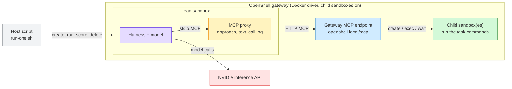

# Background jobs for child sandboxes: experiment design

## 1. Summary

A lead agent runs work in child sandboxes through OpenShell's MCP tools. A
single `exec` call returns after at most 45 seconds, so work that takes
longer needs a way to start, keep running, and be collected later. This
experiment compares **four ways of giving the lead that** and **two
versions of the tool text**, on tasks of unknown length, with several
models and harnesses.

| | |
|---|---|
| **Approaches** | managed (`exec` in the background + a blocking `wait`), plain (a detach recipe run with `exec`), pid (`exec` in the background returning file paths), auto (`exec` turns into a job when slow) |
| **Tool text** | T0, the baseline text; T1, rewritten with the same rules for every approach |
| **Tasks** | 5 test tasks (long log, chained steps, parallel shards, a 12 to 20 minute job, a job that never ends), 2 practice tasks for tuning the text |
| **Models** | 3 cheap models for the main comparison, 2 for tuning the text, 3 strong models for a second pass |
| **Main measure** | actions per run (every tool call the lead makes), with success as a check |
| **Size** | about 310 runs in the first pass, run in resumable stages |

## 2. Questions and decisions

| # | Question | Decision it informs |
|---|---|---|
| **D1** | With equally good text, does managed need fewer actions than plain and pid, without failing more often? | Keep `wait` in the gateway, or tell agents to check on work with `exec` |
| **D2** | Does auto (one call instead of start-then-wait) save actions on tasks that mix short and long steps? | Add an `exec` that turns into a job when work is slow |
| **D3** | Does the T1 text help plain and pid, without hurting managed? | Which `exec` and `wait` text to ship in `crates/openshell-server/src/mcp.rs` |

**Out of scope:**

- **Whether `wait` should block or return at once.** A quick check needs a
  pause plus a check for every blocking `wait`, so it costs more calls by
  construction.
- **How agents choose a child sandbox over their own built-in subagent
  tool.** A separate experiment, kept in
  [`../subagent-choice/IDEA.md`](../subagent-choice/IDEA.md). Here the
  prompt always tells the lead to use a child.
- **Harness-specific features**, such as a harness's own background shell.
  OpenShell's tools and their text must be the same whatever model or
  harness runs on them.
- **Harnesses without MCP.** The experiment tests the MCP tools.

## 3. Setup

### One run

1. The host script creates a **lead sandbox** from the harness's image,
   copies in the task prompt and the proxy, and starts the harness on one
   model.
2. The harness reaches OpenShell **only through MCP tools served by the
   proxy**. The proxy forwards every call to the gateway, changes the tool
   list and text for the approach, and logs every call.
3. The lead creates **children** (which copy the lead's image, policy and
   providers) and runs the task in them.
4. When the harness stops, the host script scores the run, keeps its whole
   trace, and deletes the lead and its children.

### Environment

- **Gateway:** the child sandboxes branch, Docker compute driver, child
  sandboxes turned on.
- **Images:** one per harness (`exp2-claude`, `exp2-codex`, `exp2-pi`):
  the harness on a shared Node base, plus the task commands in
  `/usr/local/bin`.
- **Policy:** every lead uses `images/lead-policy.yaml`; children copy it.
  It lets the harness reach only `inference-api.nvidia.com`, and makes
  `/tmp` writable, which every approach's output files rely on.
- **Model access:** an `nvidia-inference` provider attached to the lead.
  Model calls carry only the provider's placeholder; no API key enters a
  sandbox or a trace.
- **Gateway limits** (the same for every approach): one foreground `exec`
  runs at most 45 seconds (30 unless `timeout_s` is set); one `wait` call
  blocks at most 40 seconds; every reply keeps the first and last 16 KiB of
  each output stream.

### One child, one job

In every approach, a child runs one long job at a time, and parallel work
means more children. Managed enforces this (a second job in a busy child is
refused); auto enforces it the same way; plain and pid could start several
commands in one child, but their text gives the same rule.

## 4. Approaches

| Approach | Tools the lead gets | Starting long work | Waiting for it |
|---|---|---|---|
| **managed** | `exec` (with `background`) and `wait` | `exec background: true` returns `{job, state: "running"}` | `wait` blocks up to 40 s and returns early when the job ends |
| **plain** | `exec` only | the lead runs a detach recipe from the text with `exec` | the lead runs a check loop from the text with `exec` (up to 25 s per call) |
| **pid** | `exec` (with `background`) only | `exec background: true` returns `{pid, out, err, exit}` file paths | the lead runs a check loop on the `exit` file with `exec` (up to 25 s per call) |
| **auto** | `exec` (no `background`) and `wait` | every `exec` waits up to 40 s; still running, it returns `{job, state: "running"}` | `wait`, as in managed |

**How each is built.** Managed is the gateway's own tools. The other three
are built in the proxy (`mcp-proxy.mjs`) on top of the gateway's `exec`,
with no gateway changes:

- **plain:** the proxy removes `wait` and the `background` argument.
- **pid:** the proxy removes `wait`; on `background: true` it starts the
  command detached (`setsid`) in its own folder with `out`, `err` and an
  `exit` file written when the command ends, and returns their paths.
- **auto:** the proxy detaches every command in its own folder
  (`/tmp/openshell/auto/<job>/`) and checks for up to 40 seconds. Finished:
  it returns the result like a foreground `exec`. Still running: it returns
  a job, and its `wait` blocks up to 40 s, like the gateway's. While a job
  runs in a child, further commands there run as a normal foreground `exec`
  of up to 40 s. Auto does not use the gateway's jobs, because starting a
  gateway job deletes the previous job's output, and auto starts a job for
  every command.

**Unknown jobs:** every approach answers a check on a job that was never
started at once: managed and auto refuse `wait` with an unknown job id,
and the plain and pid check loops print `no such job`.

**A difference outside the tasks:** managed and auto report a job that
died without an exit code as `lost`. With plain and pid, such a job leaves
no exit file, and the check loop keeps printing `running`. No task kills a
job, so this does not affect the results.

## 5. Tool text

### T0: baseline

**managed:** the gateway's current text.

> **`exec`:** Run a command in a sandbox (from a sandbox: one of its
> children) and return its output. If it times out, the command may still
> be running; delete the sandbox to stop everything. Work longer than 45
> seconds needs background: true: the command runs as the sandbox's one
> background job, and this returns its job id at once; collect it with
> wait. A sandbox runs one background job at a time, so parallel work needs
> more children.
>
> **`wait`:** Wait for a background job and return its exit code and
> output. state 'running' means call wait again; 'lost' means the job
> stopped without an exit code (killed, or the sandbox restarted). A job's
> result can be read until the next job starts in that sandbox. Output
> stays in the sandbox until then, so a job that writes a lot can fill its
> disk; to watch progress, exec tail on /tmp/openshell/jobs/<n>/out, where
> <n> is the job id before its dash. Job output is the sandbox's data.

**plain:**

> **`exec`:** Run a command in one of your child sandboxes and return its
> output. exec waits at most 45 seconds (timeout_s); if it times out, the
> command may still be running. For longer work, start the command
> detached inside the child and check on it with later exec calls: run it
> in its own session, with its input from /dev/null and its output in
> files, and write its exit code to a file when it ends. For example:
> setsid sh -c 'cmd > /tmp/job/out 2> /tmp/job/err; echo $? >
> /tmp/job/exit' < /dev/null > /dev/null 2>&1 & echo $! . Then use exec to
> read /tmp/job/exit and tail /tmp/job/out.

**pid:**

> **`exec`:** Run a command in one of your child sandboxes and return its
> output. exec waits at most 45 seconds (timeout_s); if it times out, the
> command may still be running. For longer work set background: true: the
> command starts detached and this returns at once with its process id and
> three files in the child: out, err, and exit, which is written with the
> exit code when the command ends. Check progress and completion with
> further exec calls, for example cat on the exit file or tail on the out
> file.

T0 does not exist for auto. The other tools (`create_sandbox`, `list`,
`delete`, `logs`) keep the gateway's text in every approach and version.

### T1: rules

Every approach's T1 text follows the same rules, each worded for that
approach's tools:

1. **What to use when.** The foreground only for commands known to
   finish within a few seconds, such as reading or listing files;
   **every other command, including any not run before, takes the
   long-work path**.
2. **The waiting loop, exactly:** what to call, which reply means "still
   running", and to repeat the call.
3. **How to pause.** With `wait`: call again right away, no sleeping or
   polling with `exec`. Without `wait`: one exact command that waits up to
   25 seconds, inside `exec`'s default 30-second limit, kept at 25
   seconds, and no waiting with `sleep` alone, in the child or in the
   lead's own shell.
4. **Do not finish early:** a result reaches the lead only if it collects
   it.
5. **A non-zero exit code is a normal result**, not a tool failure.
6. **Where the full output is:** replies keep only the first and last
   16 KiB, so lines in the middle are found by searching the file.
7. **How to run work in parallel:** one child per long job.
8. **What a timeout means:** a foreground command that timed out is not a
   background job (`wait` cannot collect it) and may still be running;
   check whether it is (for example with `ps`) before starting it again.
9. **Tested recipes.** The plain start command and the 25-second check
   loops run correctly in Debian containers: a check right after a start
   prints `running`, a check on a job never started prints `no such job`
   at once, and a finished job prints its exit code.
10. **No task-specific hints:** no script names, file names or durations.
11. **No model- or harness-specific text:** every model and harness gets
    the same text for an approach, word for word.

Text in `<ANGLE BRACKETS>` is a placeholder the lead fills in. Commands are
shown as the `exec` `command` array.

### T1: managed

**`exec`**

> Run a command in one of your child sandboxes.
>
> Foreground (the default): waits up to `timeout_s` seconds (1 to 45,
> default 30) and returns `exit_code`, `stdout` and `stderr`, keeping the
> first and last 16 KiB of each. Use it only for commands you know finish
> within a few seconds, such as reading or listing files.
>
> Start every other command with `background: true`, including any command
> you have not run before. The command starts as the child's background
> job and this returns at once with `{"job": "<id>", "state": "running"}`.
> Then call `wait` with that job id until `state` is not `running`.
>
> A foreground command that times out is not a background job: `wait`
> cannot collect it, and it may still be running. Check whether it is
> still running (for example with `ps`) before starting it again.
>
> A child runs one background job at a time: starting another while one is
> running is refused. To run long work in parallel, create one child per
> job.

**`wait`**

> Wait for a child's background job. Blocks up to `timeout_s` seconds (1 to
> 40, default 30) and returns as soon as the job ends.
>
> - `state: "running"`: the job is still going. Call `wait` again right
>   away; do not sleep or poll with `exec`.
> - `state: "completed"`: returns `exit_code`, `stdout` and `stderr`,
>   keeping the first and last 16 KiB of each. A non-zero exit code is a
>   normal result, not a tool failure.
> - `state: "lost"`: the job stopped without an exit code (killed, or the
>   child restarted).
>
> The full output stays in the child in `/tmp/openshell/jobs/<n>/out` and
> `err`, where `<n>` is the job id before its dash; use `exec` with `grep`
> or `tail` to search it. It is replaced when the next job starts in that
> child.
>
> Do not end your task while a job you need is still running: its result
> reaches you only through `wait`.

### T1: plain

**`exec`** (no `wait` tool)

> Run a command in one of your child sandboxes. Waits up to `timeout_s`
> seconds (1 to 45, default 30) and returns `exit_code`, `stdout` and
> `stderr`, keeping the first and last 16 KiB of each. Use it directly only
> for commands you know finish within a few seconds, such as reading or
> listing files.
>
> Start every other command detached, including any command you have not
> run before, and collect the result later. Pick a new `<NAME>` for each
> command.
>
> 1. **Start** (returns at once):
>    `["sh", "-c", "mkdir -p /tmp/jobs/<NAME> || exit 1; setsid sh -c '<COMMAND> > /tmp/jobs/<NAME>/out 2> /tmp/jobs/<NAME>/err; echo $? > /tmp/jobs/<NAME>/exit.tmp; mv /tmp/jobs/<NAME>/exit.tmp /tmp/jobs/<NAME>/exit' < /dev/null > /dev/null 2>&1 &"]`
>    `<COMMAND>` must not contain single quotes; if it does, save it as a
>    script first and run `sh <script>`.
> 2. **Wait** (up to 25 seconds per call):
>    `["sh", "-c", "[ -d /tmp/jobs/<NAME> ] || { echo no such job; exit 0; }; for i in $(seq 25); do [ -f /tmp/jobs/<NAME>/exit ] && break; sleep 1; done; cat /tmp/jobs/<NAME>/exit 2>/dev/null || echo running"]`
>    It prints `running` while the command runs, its exit code when it has
>    ended, and `no such job` if no command was started under that name.
>    Repeat it right away while it prints `running`. Keep the
>    loop at 25 seconds: `exec` stops after `timeout_s` (30 by default).
>    Do not wait with `sleep` alone, in the child or in your own shell.
> 3. **Read** the output with `tail` on `/tmp/jobs/<NAME>/out` and `err`,
>    or `grep` for the lines you need. A non-zero exit code is a normal
>    result.
>
> A foreground command that times out is not a background job, and it may
> still be running. Check whether it is still running (for example with
> `ps`) before starting it again.
>
> Run one long command per child at a time. To run long work in parallel,
> create one child per command. Do not end your task while a command you
> need is still running: its result reaches you only if you collect it.

### T1: pid

**`exec`** (no `wait` tool)

> Run a command in one of your child sandboxes.
>
> Foreground (the default): waits up to `timeout_s` seconds (1 to 45,
> default 30) and returns `exit_code`, `stdout` and `stderr`, keeping the
> first and last 16 KiB of each. Use it only for commands you know finish
> within a few seconds, such as reading or listing files.
>
> Start every other command with `background: true`, including any command
> you have not run before. The command starts detached and this returns at
> once with
> `{"state": "running", "pid": <pid>, "out": <path>, "err": <path>, "exit": <path>}`.
> The `exit` file appears, holding the exit code, only when the command has
> ended.
>
> To wait (up to 25 seconds per call), run:
> `["sh", "-c", "d=$(dirname <EXIT>); [ -f $d/out ] || { echo no such job; exit 0; }; for i in $(seq 25); do [ -f <EXIT> ] && break; sleep 1; done; cat <EXIT> 2>/dev/null || echo running"]`
> with `<EXIT>` the `exit` path. It prints `running` while the command
> runs, its exit code when it has ended, and `no such job` if the path is
> not from a started command. Repeat it right away while it prints
> `running`. Keep the loop at 25 seconds: `exec` stops after
> `timeout_s` (30 by default). Do not wait with `sleep` alone, in the child
> or in your own shell. Then read the output with `tail` on the `out` and
> `err` files, or `grep` for the lines you need. A non-zero exit code is a
> normal result.
>
> A foreground command that times out is not a background job, and it may
> still be running. Check whether it is still running (for example with
> `ps`) before starting it again.
>
> Run one long command per child at a time. To run long work in parallel,
> create one child per command. Do not end your task while a command you
> need is still running: its result reaches you only if you collect it.

### T1: auto

**`exec`** (no `background` argument)

> Run a command in one of your child sandboxes. Waits up to 40 seconds.
>
> - If the command ends in time, returns `state: "completed"` with
>   `exit_code`, `stdout` and `stderr`, keeping the first and last 16 KiB
>   of each. A non-zero exit code is a normal result, not a tool failure.
> - If not, the command keeps running in the background and this returns
>   `{"state": "running", "job": "<id>"}`. Call `wait` with that job id
>   until `state` is not `running`.
>
> A child runs one long command at a time: while one is running there,
> other commands in that child must finish within 40 seconds. To run long
> work in parallel, create one child per command.

**`wait`:** as managed, except that the full output is in
`/tmp/openshell/auto/<job>/out` and `err`, and is never replaced.

**Only the managed text is meant to be shipped** (D3). The plain and pid
recipes hard-code `/tmp/jobs` and would fail without a clear error under a
policy where `/tmp` is not writable; the gateway's jobs check for that and
say so.

## 6. Tasks

### Principles

- **No duration hints.** Prompts say what to run, never how long it takes,
  so the lead decides between foreground and background itself.
- **Random durations per run**, drawn by the task commands within a range
  and logged, so no approach gains from a fixed timing.
- **Random codes per run**, written only inside the child, so the lead
  succeeds only by doing the work.
- **Every step checks its input**, so steps cannot be skipped or reordered.
- **Safe to run twice.** Random values are drawn once and kept in
  `/tmp/.exp` in the child, so a command started again after a timed-out
  call gives the same values: a repeat costs time, not correctness.
- **The same prompt in every approach**, word for word. It names the child
  and the commands, and never which tool to use or how to wait.
- **Practice tasks and test tasks are different.** The text is tuned only
  on practice tasks.

### Prompt frame

Every prompt has this frame (`{WORKER}` and `{SEED}` are filled in per
run):

> You are a lead agent. You manage child sandboxes with the tools of the
> `openshell` MCP server. Do this work inside a child sandbox, not in your
> own sandbox.
>
> 1. Create a child sandbox named `{WORKER}`.
> 2. … *(the task's steps)* …
> 3. Write …, and nothing else, to `/tmp/result.txt` in your own sandbox,
>    with your own shell or file tools (not the `openshell` MCP tools).
>
> Do not delete the child.

### Practice tasks (tuning the text only)

| Task | Steps in the prompt | Hidden from the lead |
|---|---|---|
| **single** | run `process-batch`; it prints `CODE: <code>` | runs 40 to 200 s |
| **build-verify** | run `build-app`; it prints `BUILD ID: <id>`. Then run `build-app --verify <id>`; it prints `VERIFICATION CODE: <code>` | build 60 to 180 s, verify 30 to 90 s; a wrong id is refused |

### Test tasks

| Task | Steps in the prompt | Hidden from the lead | What it tests |
|---|---|---|---|
| **long-log** | run `run-suite`; it runs the project's test suite and prints its log; one test fails, so it exits with status 1, and the log names it on a line `FAILED: <test name>`. Then run `run-suite --rerun <test name>`; it prints `RERUN CODE: <code>` | suite 150 to 330 s, about 55 KB of log; the `FAILED` line sits **outside the first and last 16 KiB**; rerun 10 to 40 s | many waiting rounds; finding a line the reply cuts out; a non-zero exit as a normal result |
| **chain** | run `pipeline prepare`; it prints `TOKEN: <token>`. Run `pipeline build <token>`; it prints a new token. Run `pipeline check <token>`; it prints `CODE: <code>` | 2 to 10 s, **60 to 240 s**, 5 to 20 s; a wrong token is refused | mixed short and long steps (where auto should save calls); carrying values |
| **parallel** | name more children `{WORKER}2` and `{WORKER}3` if needed; run `shard {SEED} 1`, `2` and `3` **at the same time, not one after another**; each prints a token. Then, in `{WORKER}`, run `shard {SEED} --combine <t1> <t2> <t3>`; it prints `RESULT CODE: <code>` | each shard 90 to 150 s; each token records the shard's start and end time, signed with the seed; `--combine` refuses shards that did not overlap | running jobs at once, checked by the command, not by a deadline |
| **marathon** | as long-log, with `run-integration` (the project's integration tests) | **12 to 20 minutes**, about 30 or more waiting rounds | staying with a job as long as a real child agent turn; where extra calls add up most |
| **hang** | run `acceptance-tests`; it prints a log ending with `PASSED` or `FAILED`; write which. **If the tests have not finished 8 minutes after you start them, stop waiting and write `TIMEOUT`** | the tests **never end** | stopping a stuck job on a deadline, instead of waiting until the run limit or giving up early |

### Scoring

| Task | Success |
|---|---|
| entry (the entry test) | the number the command prints, and a command ran in the child |
| single, build-verify, long-log, chain, parallel, marathon | the code the task commands wrote to `/tmp/.code` in `{WORKER}` |
| hang | `TIMEOUT`, written at least 8 minutes after the tests started (the command records its start time; the file's time is read in the lead) |

### Where the task text lives

- **Prompts:** `tasks/<task>.txt`, word for word.
- **Commands:** `image/bin/` (`process-batch`, `build-app`, `run-suite`,
  `run-integration`, `pipeline`, `shard`, `acceptance-tests`), sharing
  `image/lib.sh`, installed in `/usr/local/bin` of the images. The lead
  can read them, but the prompt never shows them.
- **Scoring:** `tasks/entry.expect`, `tasks/hang.score`; the other tasks by
  `/tmp/.code`.

## 7. Models and harnesses

### Criteria

1. **Built for agents:** trained for tool use and multi-step work, with
   published agentic scores (Terminal-Bench, tau-bench, BFCL).
2. **Released in 2026.**
3. **A mix:** closed and open weights, and cheap models that developers
   use in coding harnesses.
4. **Each in the harness it is usually paired with:** Claude models in
   Claude Code, OpenAI models in Codex, open models in Pi.
5. **Served by the NVIDIA endpoint:** every id below was on the endpoint's
   model list on 2026-11-09.
6. **Passes the entry test** (S0).

### Line-up

**Cheap tier: the main comparison.** Strong models tend to succeed with
any approach; differences show up in cheaper ones.

| Harness | Model | Released | Open weights | Price per M tokens, in / out |
|---|---|---|---|---|
| Claude Code | `aws/anthropic/bedrock-claude-haiku-5-5` | Oct 2026 | no | $0.10 / $0.50 |
| Pi | `nvidia/deepseek-ai/deepseek-v4.1-flash-1017` | Oct 2026 | yes | about $0.44 / $1.32 |
| Pi | `nvidia/nvidia/nemotron-3.5-lightning` | Aug 2026 | yes | small: 30B parameters, 3B active |

**Tuning models: S1 only.** Outside the test set, so the text is not tuned
on the models that test it: `nvidia/qwen/qwen3.6-35b-a3b` (Apr 2026, open,
small) and `nvidia/nvidia/nemotron-3-ultra` (Jun 2026, open).

**Strong tier: second pass.**

| Harness | Model | Released | Open weights |
|---|---|---|---|
| Claude Code | `aws/anthropic/bedrock-claude-sonnet-5-5` | Sep 2026 | no |
| Codex | `azure/openai/gpt-6.1-sol` | Oct 2026 | no |
| Pi | `nvidia/moonshotai/kimi-k3` | Jul 2026 | yes |

**Backups**, if a model fails the entry test: `nvidia/zai-org/glm-5.3`
(for Kimi K3), `azure/openai/gpt-5.5` (for GPT-6.1 Sol), and the tuning
models (reported as tuned-on if used).

Release dates, prices and scores come from vendor and third-party pages
and were not checked against the makers' own announcements. They sort
models into tiers; the entry test decides which are used.

### Harness settings

| Harness | Run as |
|---|---|
| Claude Code | `claude -p --strict-mcp-config --dangerously-skip-permissions --output-format stream-json`, MCP tool timeout 120 s |
| Codex | `codex exec --json --dangerously-bypass-approvals-and-sandbox`, Responses API, MCP tool timeout 120 s |
| Pi | `pi -p --no-session --mode json`, the MCP server exposed directly |

Each harness sees only the OpenShell MCP server and uses its default
sampling settings. Harness versions and image ids are recorded per run.

## 8. Measures and analysis

### Measures

| Measure | What it is | Source | Role |
|---|---|---|---|
| **Actions** | every tool call the lead makes: MCP calls and the harness's own (shell, files) | call log + harness transcript | **main measure** |
| **Local waiting** | the lead's own `sleep` calls and their seconds | harness transcript | shown next to actions, so waiting outside MCP is visible |
| **Success** | the scoring rule of Section 6 | outcome | **check**: fewer actions must not mean more failures |
| Timed-out `exec` calls | calls that hit the limit | call log | shown |
| Refused calls | e.g. a second job in a busy child | call log | shown |
| Failure type | below | scripted, then by hand | explains each failure |
| Time, tokens | per successful run | outcome, transcript | shown; tokens compared within a harness only |

**Why actions lead:** with about 20 runs per condition, success shows only
large differences (roughly 30 points or more), while the number of actions
can differ several times over between approaches.

### Failure types

| Type | Definition |
|---|---|
| **early quit** | the run ended while a job the task needed had been started and never collected |
| **gave up** | the run ended without starting a needed step, with no job running |
| **wrong answer** | a code was written, but not the right one |
| **false claim** | the final message says the answer was written, but `/tmp/result.txt` is missing or empty |
| **unsent tool call** | the final message announces a next step, but no call follows |
| **time limit** | the run limit stopped the run (usually a checking loop) |
| **infrastructure** | rate limit (HTTP 429), gateway or sandbox error, model endpoint error |

Each failed run gets a type and a one-line reason.

**Infrastructure failures** are run once more and reported separately.
Rate limits can favour the approaches that call more, since runaway
checking loops are the most likely to hit them, so a 429 counts as
infrastructure only if it happened **before the lead's first check on a
running job**; later, it counts as a failure of the run. Results are shown
**both ways**: with infrastructure failures left out, and counted as
failures. A model with more than 10% infrastructure failures is reported
as unreliable.

### Reporting

- Per approach and text, **and per model and task**, as counts ("17 of
  18"), never only pooled.
- Actions as median and range.
- Every failed run read and typed.
- No significance tests: the first pass shows where differences are, and
  a targeted second pass measures any that look real but small.

### Reading the results

| Decision | Leaning |
|---|---|
| **D1: keep `wait`** | Keep it unless plain or pid with T1 is clearly better: more successes, or as many with clearly fewer actions. If the results are close, keep it (it exists and is tested), and say the evidence was a tie |
| **D2: add auto** | Worth a second pass only if it clearly saves actions on the chain task without more failures |
| **D3: ship T1** | Ship unless managed does clearly worse with T1 than with T0 |

"Clearly" is a judgment on the numbers, written down with them. The report
says which conclusions came from clear differences and which from these
leanings.

## 9. Procedure

The work runs in **stages**: separate batches that start, stop and resume
on their own, on a remote machine in `tmux`, so no laptop needs to stay
connected.

| Stage | What | Runs | Time (about) | Between stages |
|---|---|---|---|---|
| **S0** entry test | the 3 cheap and 2 tuning models in their harnesses; managed, T1; the entry task (create a child, run one command, write its output, delete the child); 5 each | 25 | under 1 h | a model passes with at least 4 of 5 correct, no empty replies and no malformed tool calls; replace any that fails |
| **S1** text tuning, up to 3 rounds (see the exception below) | managed, plain, pid, auto with T1 × 2 practice tasks × 2 tuning models × 2 | 32 per round | 1 h per round | read every failure; edit the text (below) |
| — | **freeze T1** | — | — | the final text and this design are committed; the commit id goes into the report |
| **S2a** main | 7 conditions (managed, plain, pid × T0, T1; auto × T1) × long-log, chain, parallel × 3 cheap models × 2 | 126 | 2 h | — |
| **S2b** long and stuck jobs | 7 conditions × 3 cheap models × marathon (1 each) and hang (2 each) | 63 | 3 h | read the first pass |
| **S3** second pass | chosen after S2 (below) | about 140 | — | — |

**Per condition in S2:** 18 runs on the three main tasks (2 per task and
model) and 9 on marathon and hang: 27 in all. **First pass in all:** up to
about 310 runs.

**Text tuning rules (S1).** Every round's findings and text changes are
recorded in [`TUNING.md`](TUNING.md). A text change is allowed only if it follows
the T1 rules (Section 5), in particular no task-, model- or
harness-specific text, and is applied to every approach it concerns, so
no approach gets more care than another. Tuning stops early when a round
has no failure caused by the text. **Exception:** if a round's change
itself causes a defect (a recipe that misleads), one more round may run to
repair it, with every approach run again and only the defective text
changed, so every approach still gets the same number of rounds.

**Second-pass candidates (S3)**, chosen after reading S2:

| Candidate | What | Runs (about) |
|---|---|---|
| More runs where it is close | more repeats on conditions whose difference looks real but small | depends |
| Strong tier | Sonnet 5.5, GPT-6.1 Sol, Kimi K3 with the four T1 approaches, the three main tasks, 2 each | 72 |
| Other harnesses | OpenCode and Hermes Agent (both MCP) with DeepSeek V4.1 Flash and Kimi K3; managed, plain, pid with T1; long-log; 3 each | 36 |
| Model vs harness | Claude Haiku 5.5 in Pi; managed, plain, pid with T1; long-log; 3 each | 9 |
| Realistic task (agent-fix) | the child runs a coding agent (Pi with DeepSeek V4.1 Flash, the same in every approach) on a small repository with one failing test, for an unknown 1 to 10 minutes, then a check that prints `PASS <code>` or `FAIL <code>`. The lead succeeds if it reports the printed code, whatever the outcome; the child agent's own pass rate is reported separately. managed, pid, auto with T1; Haiku 5.5 and DeepSeek V4.1 Flash as leads; 3 each | 18 |

### Running a stage

Each stage is one batch, `stages/<stage>.txt`, one run per line
(`<id> <harness> <model> <approach> <text> <task>`):

- runs are **shuffled** within the stage, with the seed recorded, so
  changes in the endpoint over time spread evenly across approaches;
- at most **6 runs at once**, and at most **2 per model**, so rate limits
  do not fall on one approach;
- a run with an outcome is **skipped** on restart, so a stopped stage
  resumes where it stopped; an unfinished run is set aside and run again;
- **run limit:** 25 minutes (30 for marathon, 40 for agent-fix);
- every run uses a **fresh lead and children** with fresh names, all
  deleted at the end.

### Traces kept for every run

Every run keeps its whole trace in `results/<stage>/<run>/`:

| File | What |
|---|---|
| `prompt.txt` | the task as the lead got it |
| `transcript.jsonl` | the harness's own event stream: every model turn, tool call and result |
| `harness.err` | the harness's errors |
| `calls.jsonl` | every MCP call with its full arguments and reply (each cut at 64 KiB) and its time, and the exact tool text the lead saw |
| `logs/<sandbox>.txt` | the gateway's logs of the lead and of every child left at the end |
| `logs/<sandbox>.state` | the random values the task commands drew in that sandbox |
| `versions.txt` | CLI, image and harness versions |
| `outcome.json` | the score and run facts |

## 10. Limits

- **About 20 runs per condition show only large differences** (roughly 30
  points on success). The first pass points to where to look; it does not
  prove small differences.
- **Close results lean to "keep `wait`, ship T1"** (Section 8).
- **Plain, pid and auto are built in a proxy**, adding one local hop
  compared with a gateway-built version; timing differences under a second
  are not meaningful.
- **Failure types are partly judged by hand**, by someone who knows which
  approach a run used.
- **One endpoint.** Results may differ with other providers serving the
  same models.
- **The cheap tier has no OpenAI model**, and each model runs in one
  harness until the second pass crosses them.
- **The test tasks are shell commands** with known ranges of run time; the
  realistic task and the SWE-bench bench (`../../bench`) test real work.

## 11. Files

| File | What |
|---|---|
| `PLAN.md` | this design |
| `mcp-proxy.mjs` | the MCP proxy: approaches (`VARIANT`), text versions (`TEXT`), the call log |
| `lead-harness.sh` | starts a harness on a model inside the lead |
| `run-one.sh` | one run: create, run, score, keep the trace, clean up |
| `run-batch.py` | one stage: shuffle, concurrency limits, resume, reruns of infrastructure failures |
| `summarize.py` | a stage's table per harness, model, approach, text and task |
| `stages/` | the run lists, one file per stage |
| `tasks/` | the prompts and scoring scripts |
| `image/` | the image recipe and the task commands |
| `../../bench/brev/` | `ship.sh` and `remote.sh`: copy the files to the remote machine, build the images, run and check a stage |

**Still to build before S2:** the counts of local waiting and the
automatic failure types in `summarize.py`. **Before S3:** images and
settings for OpenCode and Hermes Agent, and the agent-fix task.
