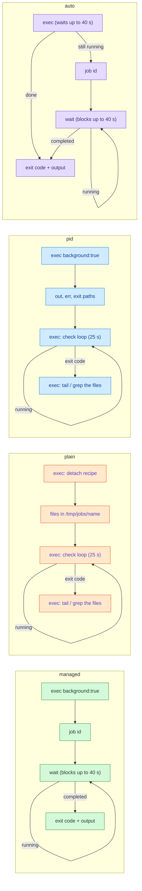
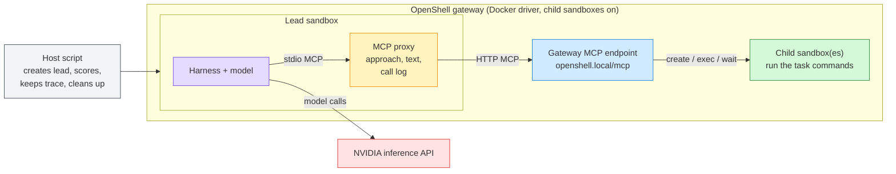
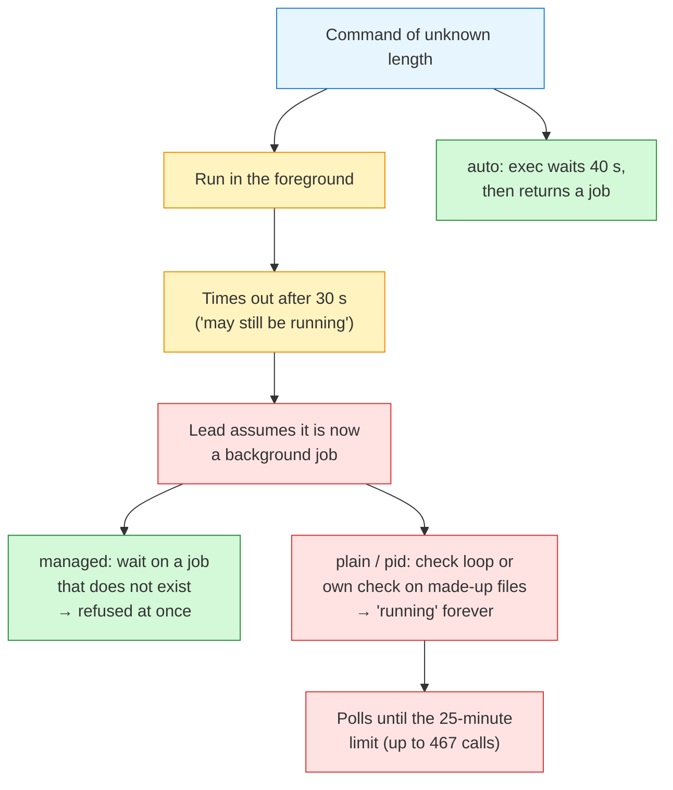

# Background jobs for child sandboxes: a second experiment

**Status: draft.** Covers all stages, S0 to S2b (342 runs). A run on real
tasks from Terminal-Bench 2.0 is being prepared. The full design is in
[PLAN.md](PLAN.md), the text tuning round by round in
[TUNING.md](TUNING.md), and observations from the traces in
[NOTES.md](NOTES.md).

## Summary

A lead agent often asks a child sandbox to run work that takes minutes.
One MCP `exec` call returns after at most 45 seconds, so the lead needs a
way to start work, leave it running, and collect the result later. This
experiment compares four ways of doing that and two versions of the tool
text, on tasks of unknown length, with five models in two harnesses.

- **Capable cheap models succeed with every approach.** Claude Haiku 5.5
  and DeepSeek V4.1 Flash completed all 84 of their main runs.
- **Auto needs the fewest actions.** With those two models it took a
  median of 10.5 tool calls per run, against 14.5 for managed, 17 for
  plain and 18.5 for pid with the same text, and it was the lowest of
  these on every task.
- **Agents do not choose foreground or background well.** Given a command
  of unknown length, they run it in the foreground, it times out, and they
  then treat it as a job that does not exist. Clearer tool text removed
  this for the capable models, but not for weaker ones.
- **What protects weaker models is the tool, not the text.** In tuning,
  managed and auto had no failures in 64 runs; plain and pid had 4, three
  of them loops that ran until the 25-minute limit.
- **Long and stuck jobs do not change the picture.** With a 12 to
  20-minute job and a job that never ends, Haiku and DeepSeek failed only
  through a rate limit or by stopping a few seconds before the deadline.
  The failures that remain are Lightning's, mostly from working in its
  own sandbox.

## The four approaches

All four give the lead the same tools to create, list, delete and read
the logs of its children. They differ only in how a long command is run
and collected.

| Approach | What the lead gets | Starting long work | Waiting for it |
|---|---|---|---|
| **managed** (the gateway's current design) | `exec` with a `background` option, and a `wait` tool | `exec` with `background: true` returns a job id at once | `wait` blocks for up to 40 seconds and returns early when the job ends; call again while it says `running` |
| **plain** | `exec` only | the lead runs a detach recipe from the tool text with `exec` | the lead runs a check loop from the tool text with `exec`, up to 25 seconds per call |
| **pid** | `exec` with a `background` option, no `wait` | `exec` with `background: true` returns the paths of the output and exit-code files | the lead runs a check loop on the exit-code file with `exec`, up to 25 seconds per call |
| **auto** | `exec` (no `background` option) and `wait` | every `exec` waits up to 40 seconds; if the command is still running, it becomes a job and the reply says so | `wait`, as in managed |

**How each works inside the child:**

- **managed:** the gateway runs a small job script in the child through
  its existing `exec` call. The script starts the command detached
  (`setsid`, its own session, output to files), records its process id
  and start time, and returns at once. `wait` checks the job every 2
  seconds with short `exec` calls and returns its exit code and the first
  and last 16 KiB of its output. The gateway keeps no state; the job lives
  in `/tmp/openshell/jobs/<n>/` in the child. A child runs one job at a
  time, and a new job replaces the previous one's output. Asking about a
  job that does not exist is refused.
- **plain:** the tool text contains two shell recipes: one starts the
  command detached and writes its output and exit code to
  `/tmp/jobs/<name>/`; the other waits up to 25 seconds for the exit-code
  file and prints `running`, the exit code, or `no such job` if nothing
  was started under that name. The lead copies them into `exec` calls.
- **pid:** like plain, but `exec` with `background: true` does the start
  and returns the file paths; the lead still waits with the check loop
  from the text.
- **auto:** `exec` starts every command detached, as pid does, then waits
  up to 40 seconds in the same call. A command that ends in time returns
  like a normal `exec`; one that does not returns a job id, and `wait`
  continues as in managed. While a job runs in a child, other commands
  there run as a normal `exec` of up to 40 seconds. The lead never has to
  choose between foreground and background.

Managed is the gateway's own tools. Plain, pid and auto are built in a
small MCP proxy in the lead, on top of the gateway's `exec`, so no gateway
change was needed to test them.

## Experimental setup

### Environment

- **Gateway:** the child sandboxes branch, Docker compute driver, on a
  remote Linux machine.
- **Lead sandbox:** one per run, from a harness image with the task
  commands installed, with `images/lead-policy.yaml` (only the inference
  API is reachable; `/tmp` is writable). Children copy the lead's image,
  policy and providers.
- **Limits** (the same for every approach): one foreground `exec` runs at
  most 45 seconds (30 unless the lead sets `timeout_s`); one `wait` call
  blocks at most 40 seconds; replies keep the first and last 16 KiB of each
  output stream; each run is stopped after 25 minutes (30 for marathon).
- **Traces:** every run keeps the harness's transcript, every MCP call
  with its full arguments and reply, the exact tool text the lead saw, and
  the gateway's logs.

### Models and harnesses

| Role | Harness | Model |
|---|---|---|
| Main comparison | Claude Code | Claude Haiku 5.5 |
| Main comparison | Pi | DeepSeek V4.1 Flash |
| Main comparison | Pi | Nemotron 3.5 Lightning |
| Tuning the text only | Pi | Qwen3.6-35B-A3B, Nemotron 3 Ultra |

All are 2026 models built for tool use; three have open weights. The
tuning models are kept out of the main comparison, so the text is not
tuned on the models that test it.

### Prompt

Every prompt tells the lead it manages child sandboxes with the
`openshell` MCP tools, that the work must happen in a child, which
commands to run, and where to write the answer. **It never says which
tool to use, how to wait, or how long anything takes.** The prompt is the
same word for word in every approach.

### Tool text

Two versions of the `exec` and `wait` descriptions:

- **T0, the baseline:** the gateway's current text for managed; for plain
  and pid, a short description with a detach example and no guidance on
  waiting.
- **T1, rewritten:** the same rules for every approach, each worded for
  its tools: use the foreground only for commands known to take seconds,
  and the background for everything else; the exact waiting loop; do not
  finish while a job runs; a non-zero exit code is a normal result; where
  the full output is; a timed-out foreground command is not a job. T1 was
  tuned in four rounds on practice tasks, then frozen. The full text is in
  [PLAN.md](PLAN.md), Section 5.

## The tasks

Each task's commands draw random durations and a random code inside the
child, and every step checks its input. The lead succeeds only by writing
the right code, which it can get only by doing the work.

| Task | What the lead runs | Hidden from the lead | What it tests |
|---|---|---|---|
| **long-log** | `run-suite`, which prints a long log and exits 1; one line names a failing test; then `run-suite --rerun <test>` | the suite runs 150 to 330 s; the failing line sits outside the first and last 16 KiB of the log | many waiting rounds; finding a line the reply cuts out |
| **chain** | `pipeline prepare`, `pipeline build <token>`, `pipeline check <token>` | 2 to 10 s, then 60 to 240 s, then 5 to 20 s | short and long steps mixed |
| **parallel** | three shards at the same time, then `shard --combine` | each shard 90 to 150 s; `--combine` refuses shards that did not overlap | running jobs at once |
| **marathon** (S2b) | like long-log, with `run-integration` | 12 to 20 minutes | staying with a long job |
| **hang** (S2b) | `acceptance-tests`; write `TIMEOUT` if not finished after 8 minutes | the tests never end | stopping on a deadline |

Two shorter practice tasks (one job of 40 to 200 s; a build then a
verify) were used only to tune the text.

## How the experiment ran

| Stage | What | Runs |
|---|---|---|
| **S0** entry test | each model, managed with T1, a trivial task; a model needs 4 of 5 to take part | 25 |
| **S1** text tuning | four rounds: managed, plain, pid, auto with T1, on the practice tasks, with the tuning models; failures read after each round | 128 |
| **S2a** main comparison | 7 conditions (managed, plain, pid with T0 and T1; auto with T1) × long-log, chain, parallel × 3 models × 2 | 126 |
| **S2b** long and stuck jobs | the same 7 conditions × 3 models × marathon (1 each) and hang (2 each) | 63 |

Runs within a stage were shuffled, with at most 6 at once and 2 per model.

## Results

### Entry test

All five models passed with 5 of 5, in 3 to 4 MCP calls and 19 to 28
seconds per run.

### Tuning the text (S1)

| Over four rounds (32 runs per approach) | managed | plain | pid | auto |
|---|---|---|---|---|
| Failures | **0** | 3 | 1 | **0** |
| Failures that ran until the 25-minute limit | **0** | 2 | 1 | **0** |
| First command run in the foreground, which timed out | every run | every run | almost every run | never |

Rewording the text across four rounds did not change the tuning models'
habit of running unknown commands in the foreground; what changed the
outcome was what the tools answered (see "What went wrong").

### Task completion (S2a)

| Model | managed T0 | plain T0 | pid T0 | managed T1 | plain T1 | pid T1 | auto T1 |
|---|---|---|---|---|---|---|---|
| Claude Haiku 5.5 | 6/6 | 6/6 | 6/6 | 6/6 | 6/6 | 6/6 | 6/6 |
| DeepSeek V4.1 Flash | 6/6 | 6/6 | 6/6 | 6/6 | 6/6 | 6/6 | 6/6 |
| Nemotron 3.5 Lightning | 3/6 | 4/6 | 2/6 | 3/6 | 4/6 | 0/6 | 5/6 |

Lightning's failures are mostly not about the approaches: in 18 of its 21
failures it ran the task commands in its own sandbox instead of a child
(see "Other observations").

### Effort: actions and timed-out calls

Median actions per run (MCP calls plus the harness's own tool calls), for
Haiku and DeepSeek, where every run succeeded:

| Task | managed T0 | plain T0 | pid T0 | managed T1 | plain T1 | pid T1 | auto T1 |
|---|---|---|---|---|---|---|---|
| long-log | 13.5 | 11 | 15 | 13.5 | 16 | 18 | 11.5 |
| chain | 10.5 | 13 | 14.5 | 13.5 | 16.5 | 17 | **8** |
| parallel | 16 | 10.5 | 17 | 18 | 20 | 20 | 12 |
| **All three** | 12 | 11 | 15 | 14.5 | 17 | 18.5 | **10.5** |

Timed-out `exec` calls, all three models together:

| managed T0 | plain T0 | pid T0 | managed T1 | plain T1 | pid T1 | auto T1 |
|---|---|---|---|---|---|---|
| 19 | 42 | 43 | **4** | 27 | 12 | 7 |

All of auto's timed-out calls came from Lightning; Haiku and DeepSeek had
none with auto.

### Long and stuck jobs (S2b)

Successes out of 3 per cell (marathon once, hang twice):

| Model | managed T0 | plain T0 | pid T0 | managed T1 | plain T1 | pid T1 | auto T1 |
|---|---|---|---|---|---|---|---|
| Claude Haiku 5.5 | 3/3 | 1/3 ² | 2/3 ¹ | 2/3 ¹ | 3/3 | 3/3 | 3/3 |
| DeepSeek V4.1 Flash | 2/3 ʳ | 2/3 ʳ | 3/3 | 2/3 ʳ | 3/3 | 1/3 ʳʳ | 0/3 ʳʳʳ |
| Nemotron 3.5 Lightning | 2/3 | 2/3 | 2/3 | 2/3 | 1/3 | 1/3 | 2/3 |

- **¹ ²: Haiku stopped a few seconds early.** Each of these 4 hang
  failures wrote `TIMEOUT` 472 to 476 seconds after the tests started,
  against a bar of 480. Haiku timed its 8 minutes from its own start call,
  a few seconds before the tests started in the child; it waited, and
  stopped, as asked. Counted as failures, but they say nothing about the
  approaches.
- **ʳ: DeepSeek was rate-limited.** Every DeepSeek failure is a run
  cut short by the inference API ("model capacity reached"), even after
  one rerun. All 13 DeepSeek runs that were not cut short succeeded.
- **Lightning** passed 9 of 14 hang runs and 3 of 7 marathon runs. In 3
  hang runs it wrote `PASSED` for tests it never saw pass; in 2 it stopped
  waiting after 5 to 6 minutes; in 4 marathon runs it went back to
  running or reading the task in its own sandbox, as in S2a.

So with capable models, all approaches waited through a 20-minute job
and stopped on a deadline. The approaches do not separate here.

### Time

The median time of successful runs was about 3 to 4.5 minutes in every
condition. It is set mostly by how long the work runs, not by how the lead
waits.

### What the T1 text changed

| All three models | managed T0 → T1 | plain T0 → T1 | pid T0 → T1 |
|---|---|---|---|
| Runs whose first command ran in the foreground and timed out | **8 → 0** | 9 → 4 | 8 → 2 |
| Timed-out `exec` calls | **19 → 4** | 42 → 27 | 43 → 12 |
| Median actions (Haiku and DeepSeek) | 12 → 14.5 | 11 → 17 | 15 → 18.5 |

T1 did what it was written for: leads put unknown commands in the
background first, and timeouts fell sharply. But actions rose, because
leads also put short commands (such as a 5-second `pipeline prepare`) in
the background, so one call became a start and a wait. Auto has no such
cost: a short command finishes within its first call.

## What went wrong

- **Foreground first.** Without clear guidance (T0, and the weaker tuning
  models even with T1), leads run a command of unknown length in the
  foreground. Their reasoning goes straight from "now I need to run the
  command" to a foreground call.
- **A timed-out command mistaken for a job.** The timeout reply says the
  command "may still be running". Leads read that as "it is in the
  background now" and wait for a job that was never started; one wrote:
  "The command timed out, meaning it's still running in the background."
- **The tool's answer decides the cost.** Managed's `wait` refuses an
  unknown job, so the mistake costs one call. Plain and pid's check loops
  answer `no such job`, but only for leads that copy them; leads that
  wrote their own check on a made-up path polled it until the run limit.
- **Improvised waiting.** Without a blocking call, leads lengthened the
  check loop past `exec`'s limit (so it timed out), slept in their own
  shell, or polled with bare `sleep`.

## Other observations

- **Lightning often worked in its own sandbox.** In 18 of its 21 S2a
  failures, it ran or examined the task commands in the lead with its own
  shell, against the prompt, and wrote a code its own sandbox produced. The
  commands exist in the lead's image because children copy it. The runs
  were kept as they are ([NOTES.md](NOTES.md)). It did the same in 4
  marathon runs; with pid, it looked for the child's job files at the
  returned paths in its own sandbox, where they do not exist.
- **Results made up under a deadline.** In the hang task, Lightning three
  times wrote `PASSED` after reading a partial log or rerunning the tests
  with a 30-second limit. No capable model did this.
- **Short commands backgrounded.** With T1, capable leads followed "use
  the background unless the command takes seconds" for every command,
  including short ones, which added calls.
- **Refused calls** were mostly `wait` on a job that did not exist (after
  a foreground timeout) and requests for timeouts above the limits.
- **The leading harnesses avoid the choice.** As far as public sources
  show, Codex CLI waits a bounded time for each command and returns a
  session id if it is still running, and Claude Code moves a command that
  reaches its timeout to the background. Both are close to auto. (From
  third-party ports and issue reports; to be confirmed against official
  documentation.)

## Limits of this experiment

- **About 18 runs per condition** in S2a, 6 per model: large differences
  are visible, small ones are not.
- **Two of the three main models succeeded every time,** so success does
  not separate the approaches for them; actions do.
- **Lightning often worked in its own sandbox,** which blurs its results.
- **The tasks are synthetic commands** with known ranges of run time.
- **Rate limits cut 8 of 21 DeepSeek runs in S2b,** so its S2b results do not
  compare the approaches.
- **The hang deadline is scored from the start of the tests,** not from the
  lead's start call, so a lead that times 8 minutes itself can miss it by
  a few seconds.
- **Each model ran in one harness;** the cheap models include no OpenAI
  model.
- **Plain, pid and auto are built in a proxy,** not in the gateway.
- **Failures were classified by reading traces,** by someone who knew each
  run's approach.

## Conclusion

Starting long work is easy for every model; deciding **when** to start it
in the background, and **what a timeout means**, is where agents go wrong.
Clear tool text fixes this for capable models, but weaker models ignore
it, and then the tool's own answers are what keep a mistake from turning
into a failure.

Long and stuck jobs (S2b) did not change this. On the decisions:

| Decision | Leaning | Evidence |
|---|---|---|
| **D1: keep `wait`** | **Keep it** | With T1, managed needed fewer actions than plain and pid, and in tuning it had no failures: its `wait` catches a mistaken job at once |
| **D2: add auto** | **Promising; worth building** | The fewest actions of the T1 conditions on every task, no timed-out calls with the capable models, no foreground or background choice to get wrong, and close to what the leading harnesses do. A gateway version needs `exec` to start a job and wait in one call, and job output kept until it is read |
| **D3: ship T1** | **Ship it for managed** | It removed foreground-first runs (8 to 0) and most timeouts (19 to 4) with the capable models, at the cost of a few extra calls for short commands |

A design idea from the traces, close to auto: a foreground `exec` that
times out could return a job for `wait`, instead of a dead end.
