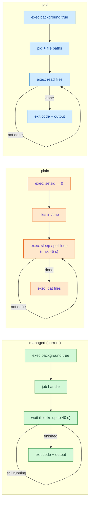
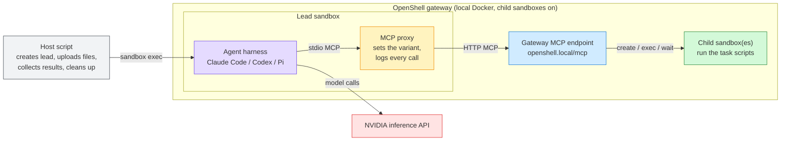
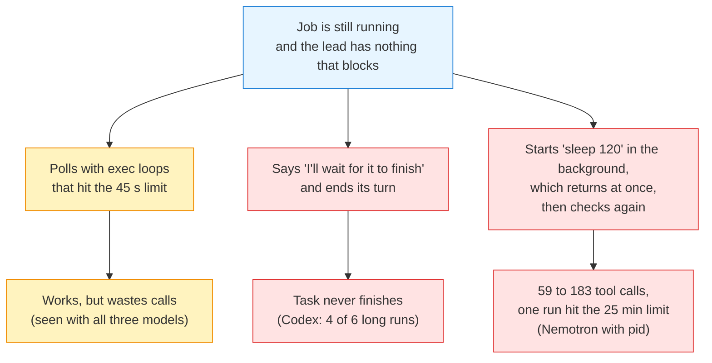

# Background jobs for sandboxed subagents: an experiment

## Summary

A lead agent often asks a child sandbox to run work that takes minutes. One
MCP `exec` call stops after at most 45 seconds, so the lead needs some way to
start work, leave it running, and come back for the result. This experiment
compares three ways of giving it that, using three models, on three tasks,
in 63 runs.

- The **managed** approach (background jobs plus a blocking `wait` tool, as
  currently built) completed every run: 18 of 18 on the hard tasks.
- The two simpler approaches completed every short or parallel task, but
  failed on a long task: **plain** 15 of 18, **pid** 16 of 18.
- The failures were not about running the work. They were about **waiting**
  for it. Without a tool that blocks, one model ended its turn while the job
  was still running, and another polled in a tight loop of up to 183 tool
  calls.
- Total time was about the same for all three approaches. It is set by how
  long the work runs, not by how the lead waits.

## The three approaches

| Approach | What the lead gets | How the lead waits |
|---|---|---|
| **managed** (current) | `exec` with `background: true` returns a job handle. A `wait` tool returns the result when the job ends. | `wait` blocks for up to 40 seconds per call and returns early when the job finishes. |
| **plain** | Only foreground `exec`. Its description explains how to detach work with `setsid` and write the output and exit status to files. | The lead checks the files with more `exec` calls, using `sleep` or a polling loop. |
| **pid** | `exec` with `background: true` starts the work detached and returns its process id and the paths of its output and exit files. No `wait`. | The lead reads the files with more `exec` calls. |

## Experimental setup

### Environment

- **Gateway.** A local OpenShell gateway with the Docker compute driver and
  `OPENSHELL_EXPERIMENTAL_CHILD_SANDBOXES=1`. It runs the code from the child
  sandboxes branch, which includes the background job implementation.
- **Lead sandbox.** One root sandbox per run, created from the
  `child-<harness>:local` image (Claude Code, Codex or Pi on the same Node
  base) with `examples/child-sandboxes/images/lead-policy.yaml`. That policy
  lets the harness reach only `inference-api.nvidia.com`. The lead talks to
  the gateway through the MCP endpoint that every sandbox can reach at
  `http://openshell.local/mcp`.
- **Child sandboxes.** The lead creates these itself with `create_sandbox`.
  They inherit the lead's policy. Each run uses fresh names, so nothing is
  shared between runs.
- **Models.** Every model call goes through an NVIDIA inference provider
  attached to the lead, so no real API key enters a sandbox.

  | Harness | Model |
  |---|---|
  | Claude Code | `aws/anthropic/bedrock-claude-sonnet-5-5` |
  | Codex | `openai/openai/gpt-5.3-codex` |
  | Pi | `nvidia/nvidia/nemotron-3-ultra` |

- **Harness settings.** Each harness runs non-interactively with tool
  approvals turned off, and sees only the OpenShell MCP server.
  - Claude Code: `--strict-mcp-config --dangerously-skip-permissions --output-format stream-json`.
  - Codex: `exec --json --dangerously-bypass-approvals-and-sandbox`, with a 120 second MCP tool timeout.
  - Pi: `-p --no-session --mode json`, with the MCP server exposed directly.
- **Variant switch.** A small stdio MCP proxy sits between
  the harness and the gateway. It forwards every call unchanged, except
  that it rewrites the tool list for the chosen variant:
  - **managed:** passes everything through.
  - **plain:** removes `wait` and the `background` option, and adds the
    detaching recipe to the `exec` description.
  - **pid:** removes `wait` and implements `background` itself.

  It logs every tool call with its duration, whether it timed out, and any
  refusal.
- **Limits.** These are the gateway's normal limits, the same in every
  variant:
  - one foreground `exec` runs for at most 45 seconds (30 by default);
  - one `wait` call blocks for at most 40 seconds;
  - each reply keeps the first and last 16 KiB of each output stream;
  - each run is stopped after 25 minutes.
- **Scoring.** After the run, the host script compares `/tmp/result.txt` in the
  lead with the value the task script wrote inside the child. A run
  succeeds when they match. The value is random for every run, so the lead
  can only get it by doing the work. The script also checks every step's
  input, so steps cannot be skipped or reordered.
- **Repeats.** The pilot ran each combination once. The two hard tasks ran
  each combination three times. Runs in a batch ran at the same time.

### Prompt

Every task prompt tells the lead what it is, that its tools come from the
`openshell` MCP server, that the work must happen in a child, and where to
write the answer. It never says which tools to use or how to wait. Each
variant gets the same prompt word for word, so the tool list and its
descriptions are the only difference.

### Tool text in each approach

The proxy (`mcp-proxy.mjs`) changes only the `exec` and `wait` tools; the
other tools (`create_sandbox`, `list`, `delete`, `logs`) are the same in
every approach. The run transcripts confirm the leads saw this text.

| | managed | plain | pid |
|---|---|---|---|
| `wait` tool | present | removed | removed |
| `exec` `background` argument | returns a job id | removed | returns a process id and three file paths |
| `exec` description | the gateway's own | rewritten (below) | rewritten (below) |

**managed: `exec`** (from `crates/openshell-server/src/mcp.rs`)

> Run a command in a sandbox (from a sandbox: one of its children) and
> return its output. If it times out, the command may still be running;
> delete the sandbox to stop everything. Work longer than 45 seconds needs
> background: true: the command runs as the sandbox's one background job,
> and this returns its job id at once; collect it with wait. A sandbox runs
> one background job at a time, so parallel work needs more children.

**managed: `wait`** (input `name`, `job`, `timeout_s` at most 40)

> Wait for a background job and return its exit code and output. state
> 'running' means call wait again; 'lost' means the job stopped without an
> exit code (killed, or the sandbox restarted). A job's result can be read
> until the next job starts in that sandbox. Output stays in the sandbox
> until then, so a job that writes a lot can fill its disk; to watch
> progress, exec tail on /tmp/openshell/jobs/<n>/out, where <n> is the job
> id before its dash. Job output is the sandbox's data.

**plain: `exec`**

> Run a command in one of your child sandboxes and return its output. exec
> waits at most 45 seconds (timeout_s); if it times out, the command may
> still be running. For longer work, start the command detached inside the
> child and check on it with later exec calls: run it in its own session,
> with its input from /dev/null and its output in files, and write its exit
> code to a file when it ends. For example: `setsid sh -c 'cmd >
> /tmp/job/out 2> /tmp/job/err; echo $? > /tmp/job/exit' < /dev/null >
> /dev/null 2>&1 & echo $!` . Then use exec to read /tmp/job/exit and tail
> /tmp/job/out.

**pid: `exec`**

> Run a command in one of your child sandboxes and return its output. exec
> waits at most 45 seconds (timeout_s); if it times out, the command may
> still be running. For longer work set background: true: the command
> starts detached and this returns at once with its process id and three
> files in the child: out, err, and exit, which is written with the exit
> code when the command ends. Check progress and completion with further
> exec calls, for example cat on the exit file or tail on the out file.

What a background start returns:

| Approach | Reply |
|---|---|
| managed | `{"job": "1-5a48536f", "state": "running"}`; then `wait` returns the state, exit code, and the first and last 16 KiB of stdout and stderr |
| pid | `{"state": "running", "pid": 143, "out": ".../out", "err": ".../err", "exit": ".../exit"}` |
| plain | nothing from the tool; the agent's own `setsid ... & echo $!` prints the process id |

## The tasks

### 1. Build and verify (pilot)

Two slow steps in a row, where the second needs the output of the first.

1. Create a child, save a script, and run `sh /tmp/build.sh`. It runs for
   about 90 seconds and prints a random build id.
2. Run `sh /tmp/build.sh --verify <build id>`. It runs for about 60 seconds
   and prints a random verification code. A wrong build id fails.
3. Write the code to `/tmp/result.txt` in the lead.

**What it tests:** whether the lead can run work longer than one `exec`
call, and carry a value from one job to the next.

### 2. Parallel shards

Three slow jobs that must overlap.

1. Create a child. The prompt allows up to two more.
2. Run `sh /tmp/shard.sh 1`, `2` and `3`. Each takes about 100 seconds and
   prints a token that depends on a random seed in the prompt.
3. Run `sh /tmp/shard.sh --combine <t1> <t2> <t3>` in the first child. It
   checks all three tokens and prints a random result code.
4. The prompt says the task must finish within 5 minutes. One after
   another, the shards alone would take 5 minutes.

**What it tests:** running several jobs at once. The managed approach
allows only one job per child, so the lead has to spread the jobs across
children, or run them inside a single job. The other approaches can run
all three in one child.

### 3. Long noisy suite

One long job with a large log.

1. Create a child and run `sh /tmp/suite.sh`. It runs for about 4 minutes,
   prints about 62 KB of log, and exits with status 1. One line in the
   middle, about 30 KB in, names the failing test.
2. Run `sh /tmp/suite.sh --rerun <test name>`. It runs for about 30 seconds
   and prints a random code. A wrong test name fails.
3. Write the code to `/tmp/result.txt` in the lead.

**What it tests:** waiting through many polling rounds, and getting a
line that falls outside the 16 KiB kept from each end of a reply. A
non-zero exit status is part of the normal outcome.

## Results

### Task completion

| Task | Model | managed | plain | pid |
|---|---|---|---|---|
| Build and verify (1 run) | Claude Sonnet 5.5 | 1/1 | 1/1 | 1/1 |
| | GPT-5.3-codex | 1/1 \* | 1/1 | 1/1 \* |
| | Nemotron 3 Ultra | 1/1 | 1/1 | 1/1 |
| Parallel shards (3 runs) | Claude Sonnet 5.5 | 3/3 | 3/3 | 3/3 |
| | GPT-5.3-codex | 3/3 | 3/3 | 3/3 |
| | Nemotron 3 Ultra | 3/3 | 3/3 | 3/3 |
| Long noisy suite (3 runs) | Claude Sonnet 5.5 | 3/3 | 3/3 | 3/3 |
| | GPT-5.3-codex | 3/3 | **0/3** | **2/3** |
| | Nemotron 3 Ultra | 3/3 | 3/3 | **2/3** |
| **Hard tasks total** | | **18/18** | **15/18** | **16/18** |

\* In the pilot, Codex found the right code in all three runs. In two runs
it tried to write `/tmp/result.txt` through the MCP `exec` tool instead of
its own shell. The gateway refused, because the lead is not its own child.
Codex then only reported the code. That is a prompt ambiguity, not a
background job issue, and the hard tasks' prompts fix it. The table counts
these runs as completed.

### Effort: tool calls and timed-out calls

The median number of tool calls per run on the long noisy suite, and the
number of `exec` calls that hit the 45 second limit, added up over the
three runs:

| Model | managed | plain | pid |
|---|---|---|---|
| Claude Sonnet 5.5 | 11 calls, 0 timeouts | 11 calls, 6 timeouts | 11 calls, 0 timeouts |
| GPT-5.3-codex | 11 calls, 1 timeout | 22 calls, 9 timeouts | 9 calls, 7 timeouts |
| Nemotron 3 Ultra | 13 calls, 0 timeouts | 16 calls, 8 timeouts | **100 calls, 32 timeouts** |

On the parallel task, managed runs had no timed-out calls at all. Plain and
pid runs had 0 to 9 per model.

### Time

The median wall-clock time per run, in seconds:

| Task | managed | plain | pid |
|---|---|---|---|
| Build and verify (150 s of work) | 172–189 | 182–228 | 185–212 |
| Parallel shards (100 s per shard) | 125–155 | 142–158 | 135–147 |
| Long noisy suite (about 270 s of work) | 289–305 | 297–308 \*\* | 163–332 \*\* † |

\*\* Not counting the failed runs. They ended early (Codex) or hit the 25
minute limit (one Nemotron run).

† Some pid runs (Codex in both successes, Nemotron in one) watched the log
while the suite was running, and started the rerun as soon as the failing
test's line appeared, about halfway through. That is a valid shortcut,
because the task only needs the failing test's name.

Apart from that shortcut, all three approaches finish within about
30 seconds of the work's own running time. How the lead waits costs tool
calls, not wall-clock time.

## What went wrong without `wait`

1. **Ending the turn too early (Codex, plain and pid).** Codex's last
   message in each failed run was a plan such as "Suite is still running;
   I'll now wait for completion, rerun the failed test, then write only the
   rerun code". Then it stopped, and the harness treated the task as done.
   The suite was still running in the child. With `wait` available, Codex
   called it 7 times in a row and never stopped early.
2. **Busy polling (Nemotron, pid).** With no blocking call, Nemotron tried
   to pause by starting `sleep 60`, `sleep 120` or `sleep 250` as background
   jobs. Each returned at once, so it read the files again right away. That
   loop led to 59, 100 and 183 tool calls, and one run ran until the
   25 minute limit.
3. **Polling loops that hit the limit (all models, plain and pid).** A
   common pattern was `while [ ! -f exit ]; do sleep 5; done` inside one
   `exec`. It works, but each call runs to the 45 second limit and returns a
   timeout error, which the agent then has to interpret. With `wait`, the
   same pause returns a normal "still running" reply.
4. **Claude handled all three approaches.** It worked out a safe polling
   pattern on its own, and was only slightly slower without `wait`.

## Other observations

- **One job per child was not a problem.** On the parallel task every
  model, in every approach, spread the shards across three children
  (except one pid run, which used one). No managed run tried to start a
  second job in a busy child. The prompt mentions names for extra children,
  which probably encouraged this.
- **Large output was handled the same way in every approach.** When the
  important line fell in the gap of a truncated reply, agents redirected the
  output to a file and searched it with `grep`, or read the file where the
  script saved the failing test name. This was possible in all three
  approaches, so the 16 KiB reply limit made no difference here.
- **Refused calls were almost all requests for longer timeouts** (26 of 27),
  such as `timeout_s` above 45 for `exec` or above 40 for `wait`. The agents
  read the error and retried within the limit. The other one was a
  malformed command.
- **Claude Opus 5.5 could not be used.** Its safety classifier flagged the
  pilot task as cyber-related and refused it, and Claude Code's fallback
  model was not available on this endpoint. Sonnet 5.5 ran every task
  without issue.

## Limits of this experiment

- Three runs per combination is enough to show large effects, such as
  Codex failing 4 of 6 long runs without `wait`, but not small differences
  in time or call counts.
- Each harness ran with only one model. Other models in the same harness
  may behave differently.
- The tasks are synthetic scripts with known lengths and outputs. Real
  builds and test suites vary more.
- The suite script saves the failing test's name in a file, which let some
  agents skip the log entirely. A stricter version would keep that file
  outside the child.
- The pid variant's `background` option is built into the proxy, as a shell
  wrapper run through `exec`. A version built into the gateway could
  return richer errors, but would not change the fact that there is no
  blocking call.

## Conclusion

Starting work in the background is easy for every model tested, even with
only a written recipe. Waiting for it is the hard part. A blocking `wait`
gave every model a safe way to pause, and it was the only approach with no
failures. It also kept call counts low and avoided timeout errors as part of
normal operation. The extra machinery in the managed approach (a job
directory, handles, one job per child) caused no failures in these tasks.
